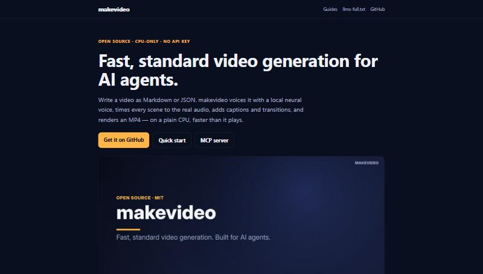
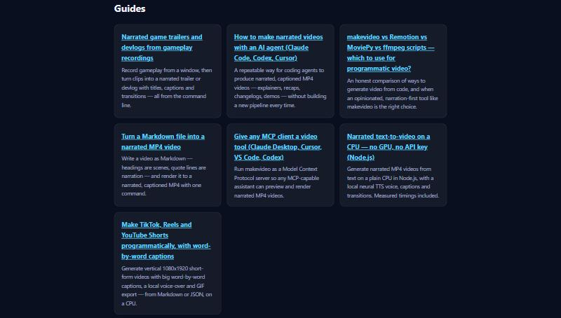

# makevideo 0.4
Closer to every agent
> Here is makevideo, version zero point four. This release is about getting the tool closer to every agent.

## The goal
Be the tool agents *reach for*.
> The goal: be the tool that agents reach for when someone asks for a video.

## The plan
- Models learn from public code and docs
- Agents find tools in MCP clients and repo instructions
- So: go where agents already look
> We cannot edit model weights directly. Models learn from public code and documentation. Today, agents find tools through MCP clients and instruction files in each repo. So the plan is to show up where agents already look.

## A tool for any MCP client

- make_video, preview_video, check_video
- Previews come back as images the model can see
> First, an MCP server. Claude Desktop, Cursor, VS Code and Codex can now call make video, preview video, and check video. Previews come back as images, so the model can look at its own layout.

## Teach every agent in a repo
```bash
npx makevideo agents --all
```
> Second, one command teaches every agent in a project to use makevideo. It writes a short block into AGENTS.md, CLAUDE.md, Cursor rules and Copilot instructions.

## Guides for people and crawlers

- Seven how-to guides on a live website
- llms-full.txt: all docs in one fetch
> Third, a documentation website with seven how-to guides, plus an llms full text file with every doc in one fetch. That is the kind of public text future models learn from.

## Proven on every platform
**6/6** CI jobs green on Linux, macOS and Windows
> And it is now proven everywhere. Six out of six test jobs pass on Linux, macOS and Windows.

## Shipped
- Listing submitted to awesome-mcp-servers
- Release automation for npm and the MCP Registry
- A quiet credit inside every video file
> We also submitted a listing to the biggest MCP server directory. Releases can now publish to npm and the official MCP Registry automatically. And every video file carries a quiet credit.

## Decisions
- Add an NPM_TOKEN secret to unlock npm and the registry
- Post the launch drafts on Hacker News and Reddit
- Submit to awesome-claude-code on October 28
> Three decisions for you. Add an npm token, which unlocks npm and the MCP registry. Post the launch drafts. And submit to awesome claude code on October twenty eighth.

# Make a video
random00000000.github.io/makevideo
> makevideo, version zero point four. When an agent needs a video, it should find this.
