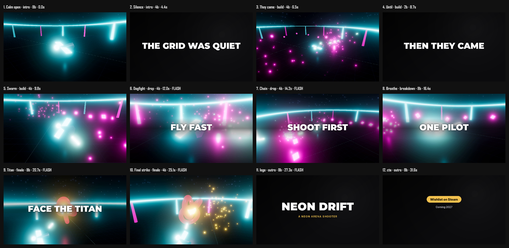

## 
Your game trailer, *from one file*.
> Your game trailer, from one file.

## Neon Drift

<!-- start: 0 -->
> This is a trailer for a small Three.js game. Every shot was filmed by the game itself, and every cut lands on the music. Nobody touched an editor.

## The real gaps, closed
- Shot list → a beat sheet
- Filming → makevideo shoot
- Editing → cuts on the beat
- Text → slams, logo, Wishlist card
> The hard part of a trailer was never frame rate. The shot list is now a beat sheet. Filming is one command. The edit cuts itself on the beat. And text, logo and the Wishlist card are built in.

## The shot list is a beat sheet
```md
## Swarm
<!-- section: build, beats: 4 -->
​```shot
setup: game.wave(18)
camera: follow hero 0,4,11
​```
THEN THEY CAME
```
> First, the shot list. Each block is one beat of the edit, measured in music beats. It says what to set up in the game, how the camera moves, and what text slams on screen.

## Two lines in your game
```js
// Electron main process
require('makevideo/electron').attach(win);

// your Three.js renderer
window.makevideo = { renderer, scene, camera };
```
> Second, you add two lines to your Electron game. That's the whole integration.

## The game films itself

<!-- start: 9.8 -->
- Runs each shot's setup code
- Orbit, push, fly and follow cameras
- Smooth 60 fps on any GPU
> Then makevideo shoot launches the game and films every shot. It runs your setup code and flies the camera. Time is stepped frame by frame, so footage is smooth even when your laptop renders the game at twenty frames a second.

## Storyboard before you shoot

<!-- fit: contain -->
> Before you film anything, preview draws a storyboard on the beat grid, in about five seconds. It also lints the trailer: gameplay in the first five seconds, logo after gameplay, short text, and a Wishlist card at the end.

## Cut on the music
**½ frame** worst cut, off the beat
> The edit is built on the music. Every cut lands within half a frame of its beat, and cuts on the big hits flash.

## Music
- A score shaped to your sections
- Or your own track: makevideo beats
- Game audio under the music, at -14 LUFS
> Three things about the music. The generated score follows your intro, build, drop and finale. Your own track works too, since makevideo beats finds its tempo. And the game's own audio sits under the music, at streaming loudness.

## How this helps you
1. init a trailer beat sheet
2. preview the storyboard
3. shoot from your game
4. render the cut
> Here's what it means for you. Write the beat sheet. Preview it. Shoot it. Render it. When the game changes, you re-shoot one shot and re-render in under a minute, so your trailer keeps up with your builds.

## Instant replay
Press *F8*. Keep the last *15 seconds*.
> And for moments you can't script, press F8 while you play to keep the last fifteen seconds.

## Decisions
- Which game gets a trailer first?
- Generated score, or your own track?
> Two decisions for you. Which game gets a trailer first? And should it use the generated score, or your own track?
